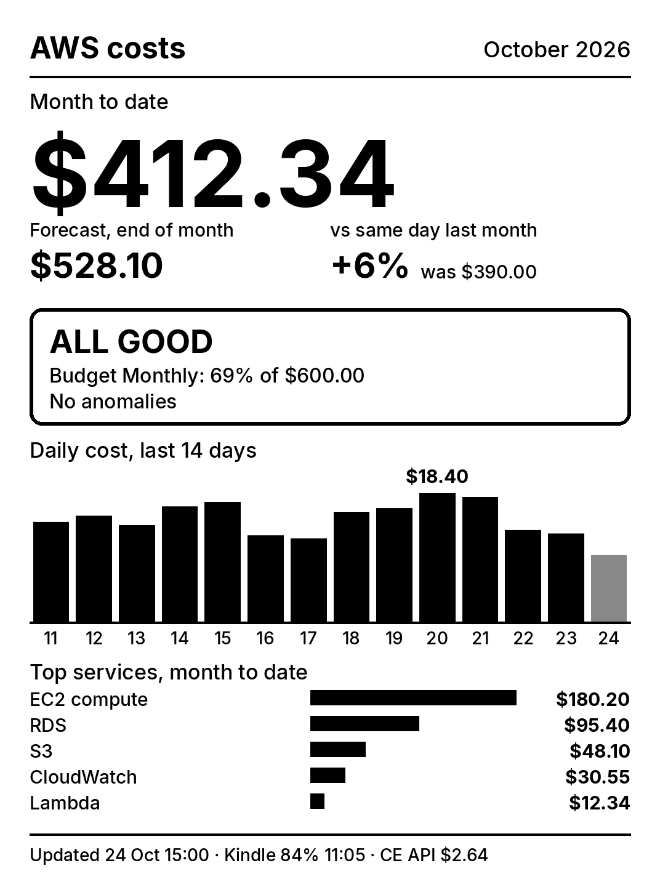
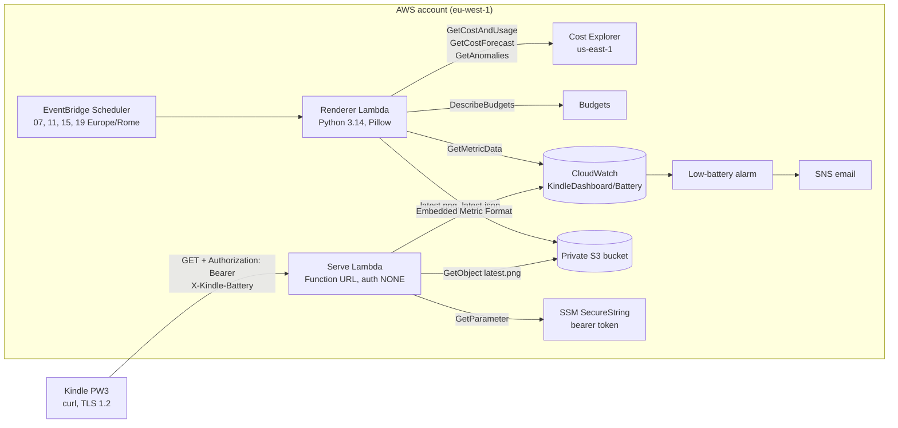

# kindle-aws-dashboard

[](https://github.com/pusi77/kindle-aws-dashboard/actions/workflows/ci.yml)

A serverless AWS FinOps dashboard for an e-ink screen: a jailbroken Kindle Paperwhite 3 running
[kindle-dash-pw3](https://github.com/pusi77/kindle-dash-pw3) shows month-to-date spend, the
forecast, budget and anomaly status, the last 14 days and the top services, refreshed every
4 hours. About $3.60/month, almost all of it Cost Explorer API calls.



All four states, with made-up numbers (normal, over budget, anomaly, missing data):
[docs/preview/overview.png](docs/preview/overview.png).

## Architecture



- **Render on a schedule, serve from S3.** The renderer runs a few minutes before the Kindle wakes
  up, calls Cost Explorer three times, draws a 1072×1448 16-grey PNG and writes it to S3. The serve
  Lambda does no rendering: one S3 read per request, so the Kindle's Wi-Fi is on for about a second.
- **The Kindle holds no AWS credentials**, only a dashboard token. It sends its battery level in a
  header; the serve Lambda turns it into a CloudWatch metric (shown in the footer, and alarmed below
  15%).
- **Lambda Function URL, no API Gateway or CloudFront.** The Kindle's curl 7.61 / OpenSSL 1.0.2
  speaks TLS 1.2 at most and trusts a 2019 CA bundle; Function URLs negotiate
  `ECDHE-RSA-AES128-GCM-SHA256` with a chain that bundle validates.
- **Any failure keeps the last image.** A failing data source shows "n/a" in its panel; a non-200
  answer leaves the Kindle's current image on screen.

## What the dashboard shows

| Panel | Source |
|---|---|
| Month to date, forecast, % vs the same day last month | `GetCostAndUsage` (DAILY, by service), `GetCostForecast` (MONTHLY) |
| ALL GOOD / LOOK HERE / NO ALERTS | Cost budgets (actual and forecast) and Cost Anomaly Detection |
| Last 14 days | same `GetCostAndUsage` call |
| Top 5 services this month | same call |
| Footer: render time, Kindle battery and last fetch, this dashboard's own Cost Explorer spend | CloudWatch, the "AWS Cost Explorer" service line |

Figures are gross usage: credits and refunds are excluded. Deployed in the management account, they
cover the whole organization.

## Setup

Prerequisites: an AWS account (the management account for org-wide figures) with Cost Explorer
enabled, the AWS CLI, Node 24, [uv](https://docs.astral.sh/uv/), and a Kindle running
kindle-dash-pw3 with `DASH_TOKEN` support. Docker is only needed if uv isn't installed.

```sh
make install                  # uv sync + npm ci
cp .env.example .env          # AWS_PROFILE and ALARM_EMAIL; .env is gitignored
npx cdk bootstrap aws://<account-id>/eu-west-1   # once per account/region
make token                    # random token into SSM, via stdin
make diff                     # review the changes
make deploy
make render                   # first image now instead of at the next slot
```

`make deploy` prints the `DashboardUrl` output. Confirm the SNS subscription email for the
low-battery alarm.

Then on the Kindle, in `/mnt/us/dashboard/local/env.sh`:

```sh
DASH_URL="<DashboardUrl output>"
DASH_TOKEN="<token>"   # aws ssm get-parameter --name /kindle-dashboard/token --with-decryption --query Parameter.Value --output text
INTERVAL_MINUTES=240
REFRESH_SCHEDULE="5 7,11,15,19,23 * * *"   # 5 min after each render; 23:05 switches to the sleep screen
```

Rotate the token with `make token` and update `DASH_TOKEN`: the serve Lambda picks up the new
value within 5 minutes.

To tear down: `npx cdk destroy`, then delete the retained S3 bucket and the SSM parameter.

## Costs

Measured on a real account, eu-west-1, October 2026 prices.

| Item | Per month |
|---|---|
| Cost Explorer API: 3 requests × 4 renders × 30 days = 360 × $0.01 | **$3.60** |
| Lambda (renderer ~4 s × 120, serve ~1 s × ~150, arm64) | < $0.01 |
| S3, SSM standard parameter, Scheduler, CloudWatch Logs | < $0.01 |
| Custom metric + alarm | $0 in the free tier, $0.40 outside it |
| **Total** | **≈ $3.60** |

The dashboard reports its own cost: the footer's "CE API" figure is the "AWS Cost Explorer" line of
the bill. Rendering more often scales that line linearly.

## Security model

- **Public endpoint, bearer token.** The Function URL has `AuthType: NONE` because the Kindle can't
  sign SigV4 requests. The serve Lambda compares `Authorization: Bearer <token>` in constant time
  with an SSM SecureString, and fails closed: an empty or missing token never matches.
- **A leaked token** gives read access to the latest PNG and lets someone send fake battery
  readings. No AWS API access, no write access. Reserved concurrency (2) caps the cost of abuse.
- **The token is never logged**: not by the Lambda, not on the Kindle (kindle-dash-pw3 passes it to
  curl through stdin and enables `DEBUG` tracing only after loading it), not in shell history
  (`make token` uses stdin).
- **Least privilege.** Each function has its own role with no AWS managed policies. The renderer is
  read-only on Cost Explorer, Budgets and CloudWatch and can write two S3 objects; the serve Lambda
  can read one object and one parameter. Tests assert the exact action lists.
- **Private bucket**: Block Public Access, SSE-S3, TLS only, retained on stack deletion.
- **cdk-nag** (AWS Solutions) runs on every synth; every suppression carries a reason in code.
- **Nothing account-specific in the repo**: the stack is account-agnostic (a test asserts the
  template has no 12-digit number), deploy-time values live in `.env`, and CI runs gitleaks.

See [SECURITY.md](SECURITY.md) for reporting a vulnerability.

## Development

```sh
make preview   # renders fixtures/*.json to docs/preview/*.png, no AWS calls
make test      # pytest + node:test (CDK assertions and snapshot)
make lint      # ruff, tsc, requirements.txt freshness
make synth     # cdk synth with cdk-nag
uv run python scripts/collect_local.py   # real, read-only collect into out/ (3 CE requests, $0.03)
```

CI runs lint, tests, `cdk synth` and gitleaks on every push and pull request, without AWS
credentials.

| Path | What |
|---|---|
| `lambdas/renderer/` | `collect.py` (AWS reads), `render.py` (Pillow), `handler.py` |
| `lambdas/serve/` | token check, battery metric, PNG from S3 |
| `lib/dashboard-stack.ts` | the CDK stack |
| `fixtures/` | made-up data for the previews and tests |
| `NOTES.md` | decisions, gotchas and measurements behind this project |

## Licence

MIT. Bundled font: [Inter](https://github.com/rsms/inter), SIL Open Font License 1.1
(`lambdas/renderer/fonts/OFL.txt`).
